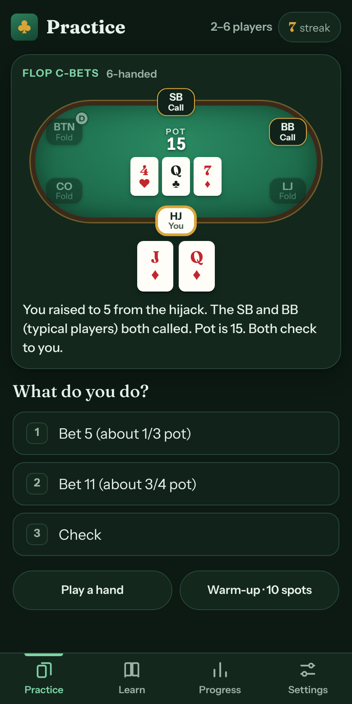
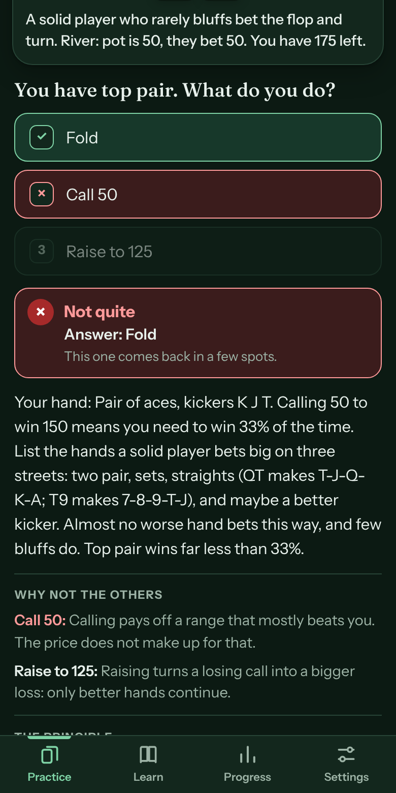
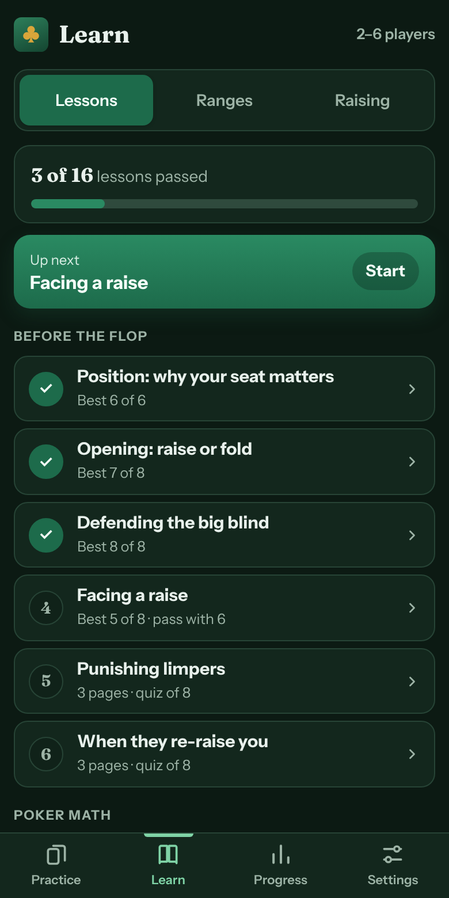
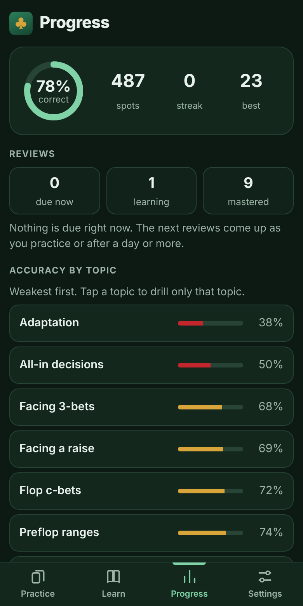
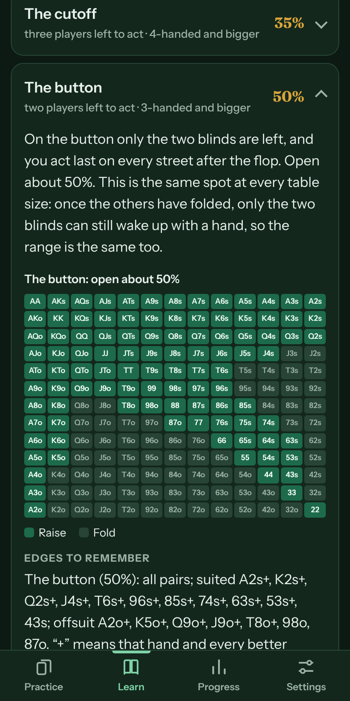

# Hold'em Drill

**A poker trainer that fits in your pocket.** Endless No-Limit Hold'em spots, graded on the spot and explained, built for live home games from heads-up to 9-handed.

**[Open the app](https://hail75.github.io/holdem-drill/)** · works offline · no account, no ads, no tracking

<p>
  
  
  
  
</p>

## What it does

- **Deals real decisions.** Every spot is generated by code: your seat, the action in front of you, the board, the bet. Fold, call or raise, with the size.
- **Tells you why.** Each answer comes with the reason, the general principle, and the mistake most players make there.
- **Brings back what you miss.** A missed spot returns three spots later, then as new versions after 10 spots, 25 spots, 1 day, 3 days and 7 days, until it sticks.
- **Teaches, not just tests.** A 16-lesson course, every preflop range chart, and a guide to raise and re-raise sizes.
- **Adapts to your table.** Pick any range of table sizes from heads-up to 9-handed. A seat plays the same range whenever the same players are left to act.

## Topics

Preflop opens · Big blind defense · Facing a raise · Facing limps · Facing 3-bets · Flop c-bets · River vs big bets · Pot odds · Draws and equity · Preflop ranges · All-in decisions · Adapting to opponents · Concepts

<p>
  
</p>

## The strategy

A solver-style baseline, adjusted to beat loose home games: players who limp, call too much, and only bet big when they have it. Tight, value-heavy ranges at 100 big blinds, with one rule above all: big pots need two pair or better.

It is a study tool, not a solver. The rules are written down in [`CLAUDE.md`](CLAUDE.md), and the tests check that the app follows them.

## Install on a phone

Open the link above in Chrome or Safari, then choose **Install app** or **Add to Home Screen**. It runs full screen and keeps working without a connection. Progress is stored on the device.

## Under the hood

- One file: [`index.html`](index.html) holds the whole app. No framework, no build step, no dependencies.
- Hand evaluator, range charts, spot generators and the review scheduler are plain JavaScript.
- Sounds are synthesized with Web Audio, so there are no audio files.
- A service worker ([`sw.js`](sw.js)) makes it an offline, installable app.

```bash
node tests/verify.mjs
```

The tests fuzz every generator at every table size and check the answers against the strategy rules: chart sizes and nesting, flop and river rules, pot-odds math, and that every lesson's quiz can be dealt.

To run it locally, open `index.html` in a browser.
